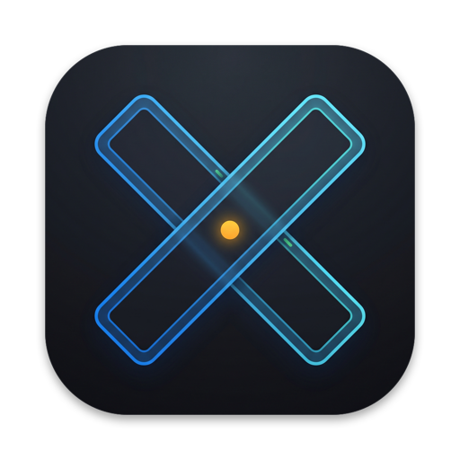
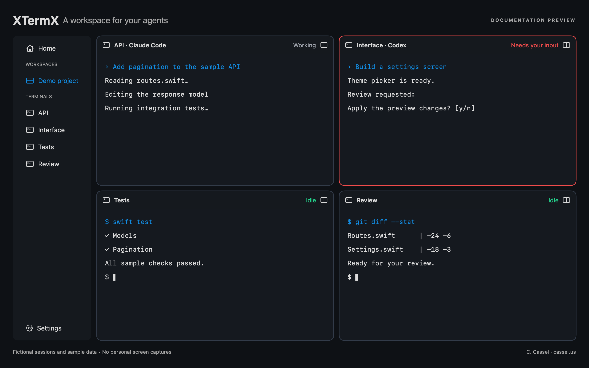
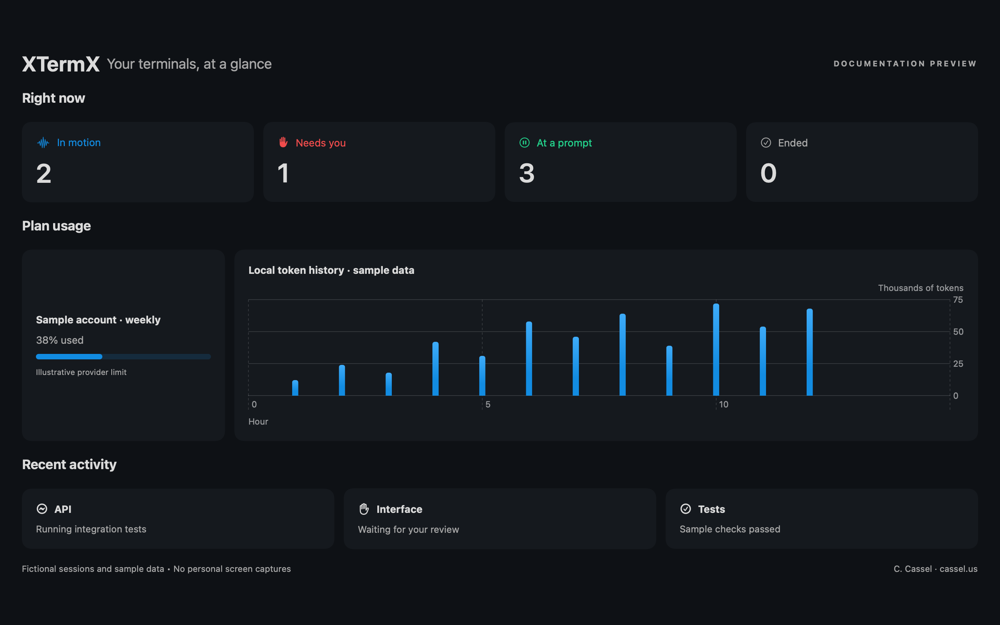

<p align="center"></p>
<h1 align="center">XTermX</h1>
<p align="center"><b>让编程智能体并肩工作，随时随地继续终端会话。</b></p>
<p align="center">原生 Mac 终端 · Linux 节点 · 加密远程会话</p>
<p align="center"><a href="README.md">English</a> · <a href="README.pt-BR.md">Português</a> · <a href="README.es.md">Español</a> · <b>简体中文</b> · <a href="https://cassel.us">C. Cassel</a></p>

XTermX 是面向编程智能体使用者的终端工作空间。你可以让 Claude Code、Codex、Gemini CLI 和其他终端工具并行运行，为每个面板命名，及时发现谁需要你的回应，并随时掌握工作进展。

**本仓库中的 Mac 应用、Linux 节点和共享库以 MIT 许可证开源。iOS 应用及其 Apple Watch 配套应用单独开发，仍为专有软件。计划未来在 App Store 上架，目前尚无公开的商店下载链接。**

如果你想使用官方配套应用，请关注本页面，上架后将提供 App Store 链接。如果你想现在自行构建桌面应用或运行 Linux 节点，请参阅[构建与运行](#构建与运行)。

## 了解 XTermX

以下图片是**文档示意预览图**，使用虚构示例数据和 XTermX 配色在屏幕之外渲染生成。它们用于说明工作流程，并非个人桌面的截图，也不是已发布版本的逐像素界面截图。图中不包含真实会话、账户、文件夹或用量数据。[预览图生成方式](Design/previews/README.md)。



你可以将面板命名为 **API**、**界面**、**测试**或**审查**。让智能体与测试终端并排显示，通过键盘切换面板，并快速发现哪个面板正在等待你的回应。



Home 按区域展示终端状态、服务商的套餐限额、本地用量图表和近期活动。服务商限额与本地 Token 估算来自不同来源，应用会明确区分。

## 主要功能

### 管理多个终端面板

- 使用工作空间标签页组织终端，支持水平和垂直分屏。
- 为面板自定义名称，按名称或最近焦点快速切换。
- 拖动分隔线、均分布局、最大化面板，或与相邻面板交换位置。
- 从包含 28 种智能体的目录启动已安装的 CLI，工具通过 `PATH` 检测。
- 使用命令面板、键盘导航、广播输入和 Control Rooms。
- 选择十种主题，调整对比度、淡化非活动面板并自定义快捷键。
- 搜索终端内容、使用 Mac 听写，并保存工作空间布局。

### 跟进智能体工作

Claude Code 和 Codex 集成可以显示会话状态、近期工具调用、任务、Token 用量及待回应的请求。聊天视图可将受支持的智能体记录分组展示，同时保留底层终端。

Home 和 Usage 展示本地历史与图表。当智能体集成提供相应服务商数据时，应用会显示套餐使用百分比。根据 Token 数量推算的费用**不等于**订阅账单总额。

可选通知支持 macOS、Telegram 和 Slack。外部通知服务由你自行配置；正常使用终端不需要启用它们。

### 连接其他机器

Mac 可以托管终端，也可以连接其他 XTermX 节点。Linux 命令行节点无需桌面应用，即可运行 PTY、远程服务器和智能体工具服务器。Mac ↔ Linux、Mac ↔ Mac、Linux ↔ Linux 使用同一协议。

使用二维码或配对链接建立连接。你可以在局域网中连接，也可以使用自己提供的网络，例如 VPN。XTermX 不提供托管中继或 VPN 服务。

Mac 还内置 SSH 客户端、主机密钥信任检查、SFTP 文件浏览器和远程文本编辑器。

### 在配套应用中继续

单独分发的 iOS 应用可以跟进同一台主机上的会话、发送文字和快捷回复、回应受支持的智能体请求，并在主机允许时发送附件。宽屏布局可同时展示两个终端。Watch 配套应用提供紧凑的会话视图和快捷操作。

**本仓库不包含 iOS、Watch 应用源码及其签名材料。** 公开共享协议和库并不意味着这些应用也已开源。App Store 上架情况将另行公布。

## 典型工作流程

1. 在 Mac 上打开 XTermX，为项目创建工作空间。
2. 启动已安装的智能体，并为面板起有意义的名称。
3. 保持终端可见，或打开 Home 集中查看活动和请求。
4. 如有需要，通过 **Machines → Add machine** 连接另一台 XTermX 机器。
5. 配套应用发布后，通过 **Remote access** 配对，继续跟进主机上的会话。

智能体账户、订阅和 CLI 安装均由你自行管理。XTermX 不附带服务商订阅，也不会绕过服务商的限制。

## 构建与运行

[下载 Mac 开发版本](https://github.com/cassel/xtermx-core/releases/tag/dev-2026.10.21-0925)：支持 Apple Silicon 和 Intel，要求 macOS 15 或更高版本。此构建采用 ad-hoc 签名，**未经 Apple 公证**；macOS 可能阻止首次打开。下方保留源码构建说明。下载不包含专有的 iOS/Watch 应用。

### Mac

要求：**macOS 15 或更高版本**、**Xcode 26 或更高版本**和 **XcodeGen**。依赖由 Swift Package Manager 解析。

```bash
git clone https://github.com/cassel/xtermx-core.git
cd xtermx-core
xcodegen generate
open XTermX.xcodeproj
```

选择 **XTermX-macOS**，在 Signing & Capabilities 中选择你自己的 Apple 开发团队，然后运行。本仓库不提供开发者证书、描述文件或私钥。

检查本地无签名构建：

```bash
xcodebuild -project XTermX.xcodeproj -scheme XTermX-macOS \
  -destination 'platform=macOS' -configuration Debug \
  CODE_SIGNING_ALLOWED=NO build
```

有关 CLI 构建、测试和 Mac 公证分发流程，请参阅[开发与分发](docs/BUILDING.md)。

### Linux

需要 Swift 6.2+ 或 Docker、Linux 用户账户，以及安装脚本中列出的依赖。脚本会安装二进制文件，并在支持时启动 systemd 用户服务；请先阅读脚本，再在自己的机器上执行。

```bash
git clone https://github.com/cassel/xtermx-core.git
cd xtermx-core
XTERMX_ADDRESSES="node.example.com" ./Server/install.sh
```

终端进程以该 Linux 用户身份运行，使用该用户安装的工具和凭据。首次源码发布未附带 Linux 二进制文件。请在目标发行版上验证运行兼容性。

手动构建 CLI：

```bash
cd Packages/XTermXKit
swift build -c release --product xtermx
.build/release/xtermx --help
```

## 配对与权限

在 Mac 上打开地球图标菜单或按 **⌘⇧G**，启用远程访问，再使用显示的链接或二维码配对。请将该配对码视为凭据：只与可信设备分享，不要将其放入截图。

- 已配对设备断开后仍会保留在历史中；显示离线不代表存在活动连接。
- 面板可以设为 **View & control**、**View only** 或 **Private**。
- 远程创建终端、接收文件和 Control Room 权限均由主机控制。
- 接收文件需要主动启用。主机可在“设置 → 远程访问”中设置附件大小限制（默认为每个文件 500 MB），并可选择设置总存储配额。更改会立即传达至已配对设备。旧版“房间与文件”上传仍限制为 4 MB。
- **Forget all devices** 会轮换配对密钥，所有设备都需重新配对。

终端帧使用 ChaCha20-Poly1305 认证加密、每次连接的新 nonce 及防重放计数器。WebSocket 端口为 **47820**，兼容 Watch 的 HTTP 传输端口为 **47821**；Bonjour 广播 `_xtermx._tcp`。能否连接取决于你的局域网、VPN 和防火墙配置。不要假设 `.local` 名称可在局域网之外使用。

报告安全问题前请阅读 [SECURITY.md](SECURITY.md)。这里描述的是实现中的机制，并不声称经过独立安全审计。

## 编程智能体工具

本地 MCP 服务器允许受支持的智能体申请范围受限的工作。是否启用智能体创建面板由你决定。创建智能体面板需要人工批准；智能体不能通过 `pane_close` 关闭面板。

| 工具 | 用途 |
|---|---|
| `pane_spawn` | 申请创建另一个智能体面板，需要批准 |
| `pane_list`、`pane_read`、`pane_send`、`pane_shell` | 在调用方权限范围内查看或操作面板 |
| `pane_wait`、`pane_report`、`pane_reports` | 等待任务并收集结果 |
| `room_members`、`room_read`、`room_send`、`room_reply` | 在分配的 Control Room 中协调智能体 |
| `pane_agents`、`machine_check`、`budget_check` | 发现智能体、检查主机负载与预算状态 |

MCP 端点仅监听回环地址，使用每个面板独立的 Token，并拒绝浏览器来源的请求。未知预算状态不视为可以继续执行。

## 键盘快捷键

下表为默认快捷键；Mac 应用的 **Settings → Shortcuts** 显示当前实际绑定。

| 快捷键 | 操作 |
|---|---|
| ⌘T / ⌘N | 新建工作空间 / 终端 |
| ⌘D / ⌘⇧D | 向右 / 向下分屏 |
| ⌘] / ⌘[ | 下一个 / 上一个面板 |
| ⌃ + 方向键 | 聚焦相邻面板 |
| ⌃⇧ + 方向键 | 将面板移动到相邻位置 |
| ⌃N | 沿当前面板较长的一侧分屏 |
| ⌃Tab | 快速切换终端 |
| ⌘⇧M / ⌘P | 最大化 / 均分 |
| ⌘K | 命令面板 |
| ⌘B / ⌘⇧B | 显示或隐藏侧栏 / 右侧面板 |
| ⌘⌥B | 广播输入 |
| ⌘⇧G | 远程访问与设备 |
| ⌘W | 关闭当前面板 |

## 选择文本与打开链接

在 Mac 上，拖动选择终端文本后按 **⌘C** 复制，即使 tmux 等程序启用了鼠标捕获也可以。按住 **Control** 悬停在网页链接上可显示下划线，点击即可在浏览器打开；也支持 **⌘点击**。按住 **Option** 点击或拖动可将鼠标操作发送给终端程序。在 **设置 → 终端 → 选择文本时复制** 中可启用自动复制。

## 项目结构

```text
Apps/macOS/                 原生 Mac 应用与设置
Packages/XTermXKit/
  Sources/XTermXKit/        模型、协议、加密、主题与客户端
  Sources/XTermXNIO/        SwiftNIO 网络传输
  Sources/XTermXHost/       PTY、主机服务、智能体集成与 MCP
  Sources/XTermXTerminalUI/ 终端渲染与 SSH 库
  Sources/xtermx/           Mac/Linux CLI
  Sources/DocumentationPreview/  仅使用虚构数据的预览渲染器
  Tests/                   共享逻辑与集成测试
Server/                    Linux 安装器、服务与 Dockerfile
Release/mac-release.sh     Mac 签名与公证流程
Design/previews/           合成的文档示意图
```

共享库包含针对 Apple 平台的条件支持。公开的 Xcode 项目**仅构建 Mac 应用**；iOS 和 Watch 应用在本仓库之外维护。

## 开发状态与贡献

XTermX 正在积极开发。最初的公开快照来自一个开发分支，其私有集成环境通过了 165 项 Swift 测试，并成功构建了 Mac、iOS 和 Watch 应用。这不代表所有实体设备或 Linux 配置都已验证。公开源码树的验证记录见 [BUILDING.md](docs/BUILDING.md)。

欢迎提交问题报告、文档改进和范围明确的贡献，请参阅 [CONTRIBUTING.md](CONTRIBUTING.md)。不要在公开 issue 或截图中包含真实终端内容、配对链接、密钥或账户数据。

## 许可证与致谢

Copyright © 2026 **C. Cassel** — [cassel.us](https://cassel.us)。

本公开仓库采用 [MIT 许可证](LICENSE)。该许可证覆盖本仓库发布的代码和材料，不授予对另行维护的专有 iOS/Watch 应用源码的权利，也不改变第三方依赖各自的许可证。

终端模拟：[SwiftTerm](https://github.com/migueldeicaza/SwiftTerm)。SSH：[Citadel](https://github.com/orlandos-nl/Citadel)。网络：[SwiftNIO](https://github.com/apple/swift-nio)。项目生成：[XcodeGen](https://github.com/yonaskolb/XcodeGen)。
